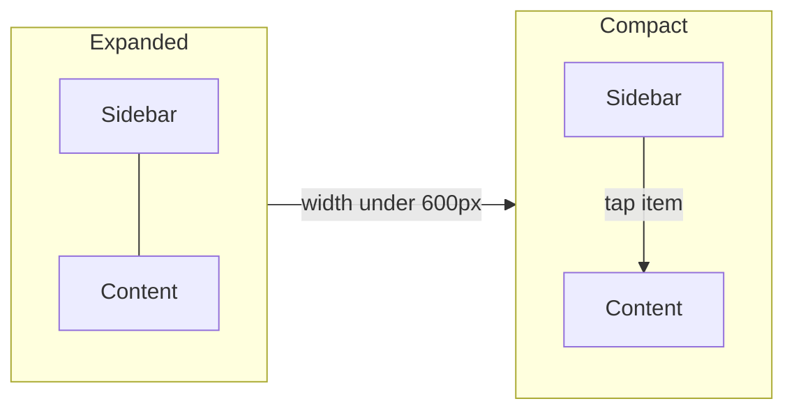

AbstractKit containers reflow at the same breakpoints the shell uses. Prefer them over checking the form factor directly.

| Breakpoint | Width | Typical layout |
| --- | --- | --- |
| `compact` | under 600 px | Single column, bottom navigation |
| `medium` | 600–1200 px | Sidebar collapses to an overlay |
| `expanded` | over 1200 px | Persistent sidebar and detail pane |



```xml filename="window.ui"
<object class="AkSplitView">
  <property name="collapse-below">compact</property>
  <child type="sidebar">
    <object class="AkNavList" id="nav"/>
  </child>
  <child type="content">
    <object class="AkStack" id="pages"/>
  </child>
</object>
```
