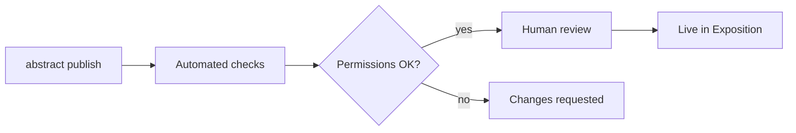

:::steps

### Build a bundle

Run `abstract build --release` to produce a `.flatpak` bundle.

### Add store metadata

Screenshots for each form factor, a description and an icon go in `store/`.

### Submit

Run `abstract publish`. Reviews usually take one to two days.

:::



```bash
abstract build --release
abstract publish --channel stable
```
