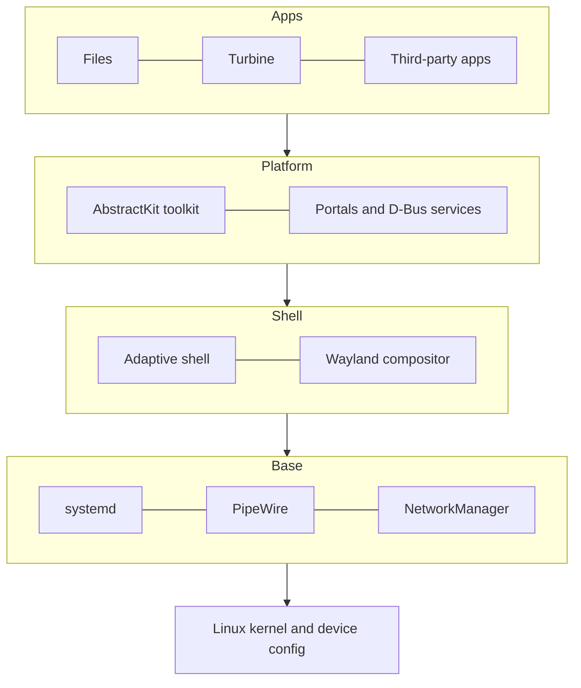

AbstractOS is a Linux distribution with a single userspace for every form factor. The same packages run on phones, tablets and PCs; only the kernel and device configuration differ.

## Components

| Layer | Component | Repository |
| --- | --- | --- |
| Shell | Compositor and shell | `abstract/shell` |
| Toolkit | AbstractKit adaptive widgets | `abstract/kit` |
| Services | Settings, notifications, portals | `abstract/services` |
| Images | Image builder and device configs | `abstract/image` |

## Design principles

- **One codebase** — no separate mobile and desktop builds.
- **Upstream first** — we contribute fixes to the kernel, Wayland and GNOME libraries rather than fork.
- **Sandboxed apps** — all apps run through portals and Flatpak.
