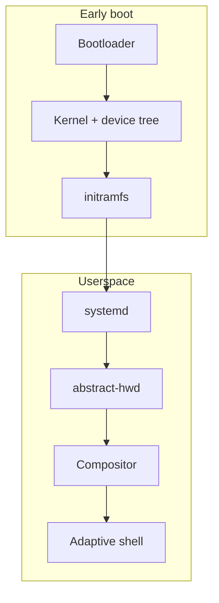

A port is a **device configuration**: a kernel, a device tree and a small TOML file describing the hardware. Everything above the kernel is shared, so most ports never touch userspace.

:::tip Talk to us first
Say hello in the `#abstractos-porting` channel on [IRC](/community) before you start. Someone may already be working on your device.
:::

## What makes a good target

- An unlockable bootloader.
- Mainline Linux support, or an active postmarketOS port to build from.
- At least 4 GB of RAM and a GPU with an open driver (Freedreno, Panfrost, Mesa).

## Boot flow



## Create a device configuration

```bash
cd image
./abstract-image new-device --vendor acme --codename falcon --arch arm64
# creates devices/acme-falcon/
```

```toml filename="devices/acme-falcon/device.toml"
[device]
name = "Acme Falcon"
codename = "falcon"
form_factor = "phone"
arch = "arm64"

[kernel]
source = "mainline"
version = "6.11"
dtb = "qcom/sm7225-acme-falcon.dtb"

[display]
width = 1080
height = 2400
scale = 2.5

[features]
touchscreen = true
camera = false
gps = true
wifi = true
lte = false
gpu = "freedreno"
```

## Bring-up checklist

| Milestone | How to verify |
| --- | --- |
| Kernel boots | Serial or `dmesg` over USB networking |
| Display | Shell renders at the native resolution |
| Touchscreen | `libinput debug-events` shows touch events |
| Wi‑Fi | `nmcli device wifi list` returns networks |
| Modem | `mmcli -L` lists the modem |
| Camera | `cam -l` lists sensors through libcamera |
| Suspend | Device sleeps and wakes on power button |

## Build, flash and submit

```bash
./abstract-image build --target arm64-acme-falcon
abstract-flash --device falcon out/abstractos-arm64-acme-falcon.img
```

When the core milestones pass, open a merge request against `abstract/image` with your device directory and a filled-in support table. Once merged, your device appears on the [Devices supported](/devices) page.
