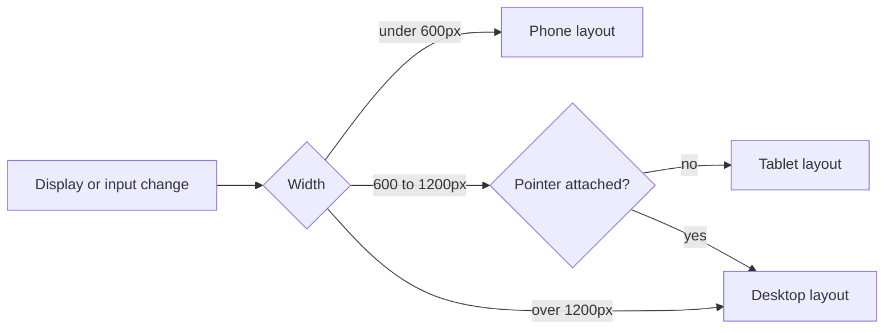

The shell is the dock, launcher, notifications and window management. It is one program that picks a layout based on screen size and input devices.

## Form factors

| Form factor | Trigger | Windows | Dock |
| --- | --- | --- | --- |
| Phone | Width under 600 px | Full screen, swipe to switch | Gesture bar |
| Tablet | Touch, width 600–1200 px | Full screen or split view | Floating dock |
| Desktop | Pointer or width over 1200 px | Free-floating, snap to edges | Bottom panel |

## Docking a phone

Connect your phone to a monitor over USB‑C. The phone screen becomes a trackpad and the monitor shows the full desktop shell with your open apps.

{width=1536 height=1024}

## Keyboard shortcuts

:::shortcuts
- `Super` — Open the launcher
- `Super` `Tab` — Switch between apps
- `Super` `←` — Snap window to the left
- `Super` `N` — Open notifications
- `Super` `L` — Lock the screen
:::
