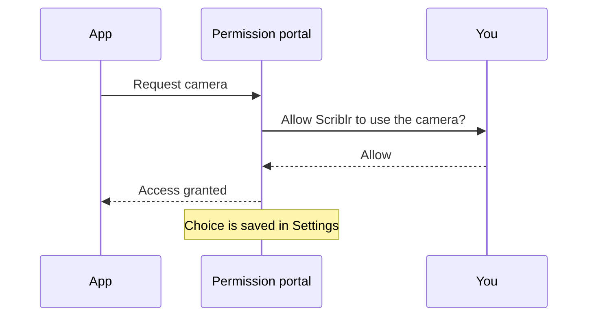

Apps in AbstractOS run sandboxed. They ask for access the first time they need a sensitive resource, and you can change your answer at any time.

## Reviewing permissions

Open **Settings → Privacy & Security** to see every app that has requested a permission. Toggle access per app, or use **Reset all** to be asked again.

:::note Indicators
A dot appears in the status area whenever the camera, microphone or location is in use.
:::
